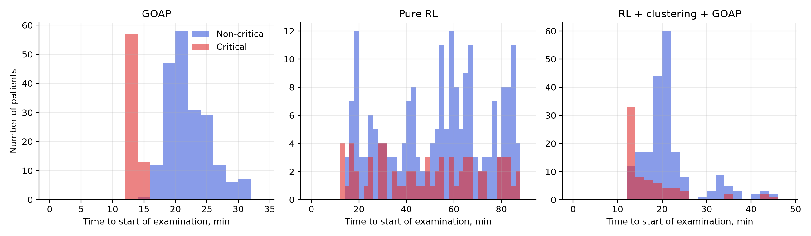
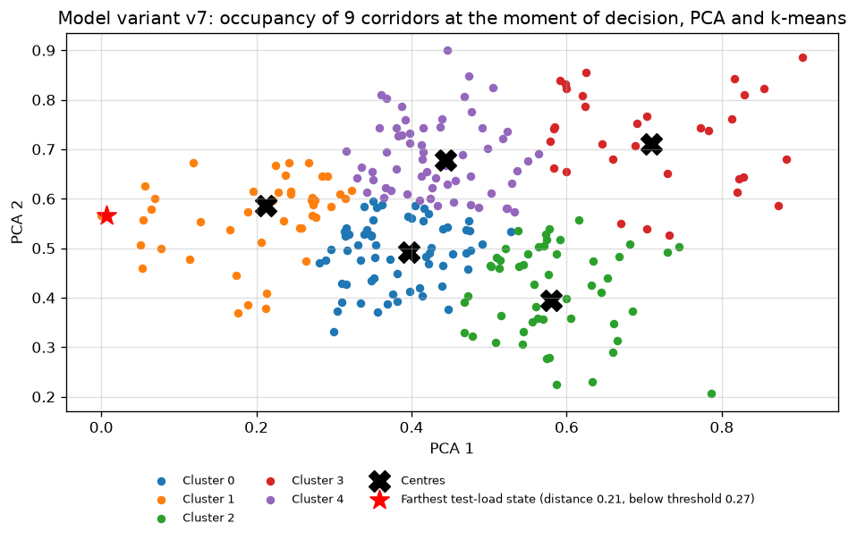
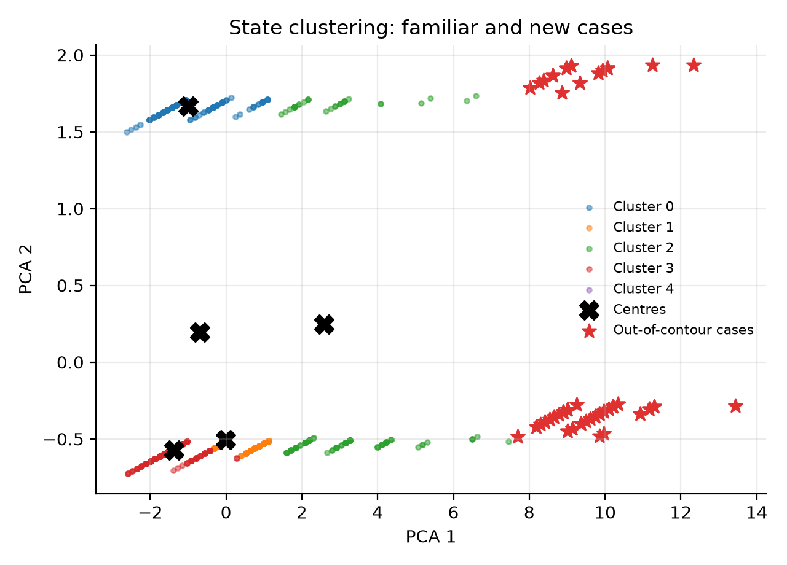

# Reinforcement learning for patient distribution inside a hospital: open re-implementation

Open code for a re-implementation of the experiment described in:

> Bondarenko G. O., Popova A. R., Syryh A. S., Patoka Y. V., Geichenko E. I., Pavluk V. S.
> *Reinforcement Learning to Optimize the Distribution of Patients within the Hospital During Emergencies.*
> 2025 XXVIII International Conference on Soft Computing and Measurements (SCM), pp. 178-181.
> DOI: [10.1109/SCM66446.2025.11060263](https://doi.org/10.1109/SCM66446.2025.11060263)

## What this repository is

The paper compares three controllers for moving patients through the corridors and boxes of an emergency department: GOAP (goal-oriented action planning),
tabular reinforcement learning trained on cases recorded from GOAP, and a hybrid in which k-means clustering of the states decides whether RL or GOAP acts.
The original code and the random seed of the paper's case study were not preserved. This repository contains an **open re-implementation**:
the model is rebuilt from the description in the paper, and its free parameters are calibrated so that the mean waiting times match the values read from the figures.

## Model

- Reception department with three one-lane corridors (routes) and several boxes; patients of two classes (critical, non-critical).
- GOAP chooses the corridor by expected time; critical patients have priority in queues.
- RL is tabular Q-learning on a sample of cases recorded under GOAP; in an unfamiliar state it takes a default action.
- Hybrid: k-means (k = 5) over the states of the sample; if the current state is farther from the centres than a threshold (quantile of the training distances), GOAP decides, otherwise RL.

## Results

Targets are the means read from the figures of the paper (critical / non-critical, minutes): GOAP 14 / 21, pure RL 53 / 49, hybrid 19 / 23.

Single run as in the paper (seed 1, 70 critical and 203 non-critical patients):

| Method | Critical, min (mean ± SD) | Non-critical, min (mean ± SD) |
|---|---|---|
| GOAP | 13.6 ± 0.6 | 22.2 ± 3.3 |
| Pure RL | 48.9 ± 23.0 | 53.2 ± 21.6 |
| RL + clustering + GOAP | 17.7 ± 7.2 | 21.6 ± 6.5 |

30 other seeds (101-130), same load (mean over seeds ± SD between seeds):

| Method | Critical, min | Non-critical, min |
|---|---|---|
| GOAP | 13.7 ± 0.2 | 22.7 ± 1.2 |
| Pure RL | 51.5 ± 10.9 | 52.4 ± 10.8 |
| RL + clustering + GOAP | 18.8 ± 0.9 | 21.6 ± 1.1 |

Control with the load of the training sample: all three controllers give 13-15 minutes (GOAP 13.3 / 15.0, RL 14.7 / 14.6, hybrid 14.6 / 14.6).
The hybrid hands 48 % of the decisions to GOAP under the test load and 0 % under the training load.



## Limits (read before citing)

- **Calibrated, not independent.** 8 free parameters were calibrated against 6 target means read from the figures. The agreement of the means is a result of calibration. The parameter set is not unique.
- **Spread of the distributions does not match.** The SD of GOAP for critical patients in the model is 0.6 minutes against about 6 in the figure of the paper. The SD of pure RL is 23 minutes against about 7 in the figure.
- **Clustering picture.** In the model behind the tables the PCA projection of the states is degenerate (two lines, second figure below), so the picture of the paper is not reproduced. The first figure below is an illustration of the clustering step from a different variant of the model (v7, state = occupancy of nine corridors). It is not the model behind the tables, and its waiting times are not reported because they were not stable across seeds. In that variant the farthest test-load state lies below the threshold, so no state is flagged as unfamiliar in that picture.
- **Pure RL is fragile only outside the training load.** At the training load RL matches GOAP; the gap appears because the test load is higher than the one RL was trained on. This is a property of this model.
- **Not clinical data.** The model is a simulation without real patients. No clinical conclusion follows from it.
- **Not the original code.** The numbers describe this model, not the model that produced the paper.





## Run

```
pip install -r requirements.txt
python code/reconstruction_report.py results
```

This writes the tables (`results/reconstruction.md`) and both figures (`rl_case_hist.png`, `rl_pca.png`). The run takes a few seconds and is deterministic.
`code/fit_rl_params.py` and `code/fit_rl_stage2.py` repeat the random search for the parameters; the chosen set is in `code/_fit_best.json`.
Code comments are partly in Russian.

## Files

- `code/reconstruct_rl_cluster.py` - the model: corridors, boxes, GOAP, tabular RL, k-means contour.
- `code/reconstruction_report.py` - case study, other seeds, control, figures.
- `code/fit_rl_params.py`, `code/fit_rl_stage2.py`, `code/_fit_best.json` - parameter search and the chosen parameters.
- `code/variant_v7/` - variant v7 of the model, used only for the clustering illustration (`python code/variant_v7/cluster_figure.py results`).
- `results.md`, `figures/` - output of the last run.

The figures of the paper are not included. They belong to the publisher.
